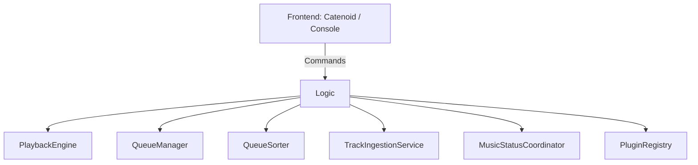

# AGENTS.md - Developer & Agent Guide for SilverAudioPlayer

This document serves as the primary technical reference and architectural guide for AI coding agents and human developers working on the `SilverAudioPlayer` codebase. It outlines the repository architecture, build system, subsystem patterns, coding standards, and step-by-step guidance for adding or modifying plugins.

---

## 1. System Overview & Technology Stack

**SilverAudioPlayer** is a highly modular, extensible, and plugin-driven audio player built on .NET. The application separates core audio orchestration from frontends and peripheral capabilities (decoders, metadata fetchers, stream sources, status broadcasters, and sync servers). Modules can be added or stripped simply by managing assembly files and `.SilverAudioPlayerModule` markers.

### Core Tech Stack:
- **Runtime & Target Framework**: .NET 10 (`net10.0`), configured via `global.json` (`SDK 10.0.2+`, `latestMajor` roll-forward) and `SilverAudioPlayer.targets`.
- **Primary GUI Frontend (`Catenoid`)**: Avalonia UI 12 (`Avalonia.Desktop`, `Avalonia.Themes.Fluent`, `Avalonia.Wayland`, `Avalonia.AvaloniaEdit`), ReactiveUI, CommunityToolkit.Mvvm, SkiaSharp.
- **Terminal Frontend (`SilverAudioPlayer.Console`)**: ANSI text-mode terminal interface with real-time synced lyrics.
- **Dependency Injection & Composition**: `Microsoft.Extensions.DependencyInjection` paired with `Silver.Composition` (a lightweight MEF import satisfaction engine implementing `[Export]`, `[Import]`, and `[ImportMany]`).
- **In-Memory Messaging**: Mediator query/handler pattern (`IMediator`, `IMediatorBus`).
- **Configuration & Persistence**: `SilverCraft.Ekorensis` (declarative UI element abstraction) and `CommentXmlConfigReaderNotifyWhenChanged<T>` (thread-safe, disk-backed XML with `FileSystemWatcher`).
- **Logging**: Serilog (`Serilog.Extensions.Logging`, global `Log.Logger`).

---

## 2. Build, Test, and Run Commands

### 2.1 Prerequisites
- **.NET 10 SDK** (verify via `dotnet --version`).
- **Optional Native Libraries** (required depending on active backend modules):
  - `libvlc` for `SilverAudioPlayer.Any.PlayProvider.libVLC`.
  - `OpenAL` / `PortAudio` for low-level spatialized or alternate audio output.
  - `libopenmpt` for tracker module decoding (MOD, S3M, XM, IT).

### 2.2 Standard Build Commands
```powershell
# Build entire solution
dotnet build SilverAudioPlayer.sln

# Build Avalonia GUI frontend (Catenoid)
dotnet build Catenoid/Catenoid.csproj

# Build Console frontend
dotnet build SilverAudioPlayer.Console/SilverAudioPlayer.Console.csproj

# Build specific plugin (e.g., NAudio provider)
dotnet build SilverAudioPlayer.NAudio/SilverAudioPlayer.Any.PlayProvider.NAudio.csproj
```

### 2.3 Running the Applications
```powershell
# Run Avalonia GUI (Catenoid)
dotnet run --project Catenoid/Catenoid.csproj

# Run Console frontend with audio files
dotnet run --project SilverAudioPlayer.Console/SilverAudioPlayer.Console.csproj -- "path/to/song.flac"
```

### 2.4 Packaging & Manifest Generation
- `SilverAudioPlayerModuleHandler.Build`: Tool that scans `.SilverAudioPlayerModule` markers, validates dependencies against `SilverAudioPlayerModules.xml`, and compiles Debian (`.deb`) or Arch packages.
```powershell
dotnet run --project SilverAudioPlayerModuleHandler.Build/SilverAudioPlayerModuleHandler.Build.csproj
```

---

## 3. Solution & Repository Layout

The solution is divided into distinct functional categories:

```
SilverAudioPlayer/
├── Catenoid/                                 # Avalonia 12 Desktop GUI host
├── SilverAudioPlayer.Console/                # Lightweight terminal frontend
├── SilverAudioPlayer.Core/                   # Central orchestration engine (Logic<T>, subsystems)
├── SilverAudioPlayer.Shared/                 # Public contracts, interfaces, and core domain models
├── Silver.Composition/                       # Lightweight MEF attribute scanner & resolver
├── SilverCraft.Ekorensis/                    # Declarative configuration UI abstractions
├── SilverCraft.Ekonrensis.Avalonia/          # Avalonia renderer for Ekorensis UI components
├── SilverCraft.Shared/                       # Shared environment and utility extensions
├── SilverAudioPlayerModuleHandler.Build/     # Modular package builder & manifest compiler
│
├── PlayProviders/                            # Audio playback & decoding engines
│   ├── SilverAudioPlayer.NAudio/             # NAudio provider & wave stream decoders (FLAC, Vorbis, etc.)
│   ├── SilverAudioPlayer.Any.PlayProvider.libVLC/ # libVLC-backed player
│   ├── SilverAudioPlayer.Any.PlayProvider.ManagedMidi/ # MIDI synthesizer provider
│   └── SilverAudioPlayer.DryWetMidi/         # DryWetMidi playback provider & parser
│
├── MetadataSources/                          # File & remote metadata gatherers
│   ├── SilverAudioPlayer.MetadataSource.Z440AtlCore/ # ATL Core tag engine
│   ├── SilverAudioPlayer.Any.MetadataSource.File/    # Fallback file metadata
│   ├── SilverAudioPlayer.Any.MetadataSource.MusicBrainz/ # MusicBrainz metadata gatherer
│   └── SilverAudioPlayer.Any.MetadataSource.SLIbIndex/ # SLibIndex metadata provider
│
├── MusicStatusInterfaces/                    # OS status & scrobbler integrations (MSI)
│   ├── SilverAudioPlayer.DiscordRP/          # Discord Rich Presence
│   ├── SilverAudioPlayer.Any.MusicStatusInterface.ListenBrainz/ # ListenBrainz scrobbling
│   ├── SilverAudioPlayer.Windows.MusicStatusInterface.SMTC/     # Windows System Media Transport Controls
│   ├── SilverAudioPlayer.Windows.MusicStatusInterface.FortniteCarRadio/ # Fortnite Radio protocol integration
│   ├── SilverAudioPlayer.Linux.MPRIS/        # Linux MPRIS D-Bus interface
│   └── SilverAudioPlayer.Any.MusicStatusInterface.LyricsSyncer/ # Lyrics synchronization service
│
├── PlayStreamProviders/                      # Media catalogs and network sources
│   ├── SilverAudioPlayer.Any.PlayStreamProvider.LocalLibrary/  # Local disk library browser
│   ├── SilverAudioPlayer.Any.PlayStreamProvider.JellyFin/       # Jellyfin media server provider
│   └── SilverAudioPlayer.Any.PlayStreamProvider.SLibIndex/      # Indexed library provider
│
├── PlayListReaders/                          # Playlist format parsers
│   ├── SilverAudioPlayer.Any.PlayListReader.M3U/  # M3U / M3U8 reader
│   ├── SilverAudioPlayer.Any.PlayListReader.SPL/  # Native SilverPlaylist (.spl.br) reader
│   └── SilverAudioPlayer.Any.PlayListReader.XSPF/ # XSPF playlist reader
│
├── PlatformHelpers/                          # OS-specific helpers & power management
│   ├── SilverAudioPlayer.Windows.PlatformHelper.Win10/
│   └── SilverAudioPlayer.Linux.PlatformHelper.Linux/
│
├── Sync/                                     # Remote control & companion sync services
│   ├── SilverAudioPlayer.Any.Sync/           # Network sync client/server
│   ├── SilverJuke/                           # Web-based jukebox remote frontend
│   └── SilverJukeClient/                     # Generated API client for SilverJuke
│
└── Configuration & Targets:
    ├── global.json                           # Enforces .NET 10 SDK
    ├── SilverAudioPlayer.targets             # Centralized build flags & versioning (8.6.0)
    ├── SilverAudioPlayer.Avalonia.targets    # Avalonia package bundle imports
    └── SilverAudioPlayerModules.xml          # Module dependency and packaging manifest
```

---

## 4. Key Architectural Patterns & Subsystems

### 4.1 `Logic<T>` Facade and Subsystems
The core engine is encapsulated within `Logic<T>` (`SilverAudioPlayer.Core/Logic.cs`), where `T : PlayerContext`:
- **`PlaybackEngine`**: Handles playback state machine transitions (`Play`, `Pause`, `Stop`, `Resume`, seeking), volume control, and gapless audio pre-buffering.
- **`QueueManager`**: Thread-safe playlist queue collection, track movement, shuffling, and pointer tracking (`NextSong`).
- **`QueueSorter`**: Asynchronous fuzzy album and track sorting via `FuzzySharp`.
- **`TrackIngestionService`**: Asynchronous file, directory, URL, and playlist reader and resolver.
- **`MusicStatusCoordinator`**: Dispatches playback state changes to registered `IMusicStatusInterface` plugins.
- **`IPlayerUiBridge`**: Decouples UI-specific callbacks (message boxes, notifications) from core business logic.



### 4.2 Dynamic Plugin Composition (MEF via `Silver.Composition`)
Instead of hardcoding dependencies, the player dynamically imports plugins:
1. Plugins decorate export classes with `[Export(typeof(INTERFACE))]` and implement `ICodeInformation`.
2. Bootup uses `PlatformLogicHelper.SatisfyImports(Logic, serviceProvider)` to reflect over `[ImportMany]` and `[Import]` fields in `ILogicImportable`.
3. Discovered plugins are populated into `PluginRegistry` (`IPlayProvider`, `IMetadataProvider`, `IMusicStatusInterface`, `IPlayStreamProvider`, `IPlaylistReader`, `ISyncPlugin`).

### 4.3 In-Memory Mediator Pattern
Cross-cutting queries use `IMediatorBus`:
- Queries inherit `IQuery<TResult>` (e.g., `RequestMusicBrainzInfo`, `RequestReplayGainInfo`).
- Handlers (`MusicBrainzHandler`, `ReplayGainHandler`) inspect incoming payloads inside `HandleMediatorQuery(QueryEventArgs, Song)` and assign results if handled.

### 4.4 Track Entity, Metadata & Synced Lyrics
- **`Song` (`SilverAudioPlayer.Shared/Song.cs`)**: Central reactive track entity inheriting from `ReactiveObject`.
- **Deterministic GUIDs (`CurrentGuidHashingAlgorithm`)**: Generates an RFC 4122 v8 SHA256-based GUID from cleaned metadata (`artist\0album\0disc\0track\0title`) or normalized file paths, ensuring stable track identities across sessions.
- **`MetadataCombo`**: Aggregates metadata from multiple gatherers, prioritizing local file tags over remote sources and merging bitrates, sample rates, and lyrics.
- **`LrcParser`**: Parses both standard and enhanced bracketed LRC lyrics (`[MM:SS.XX]`) with millisecond timestamps into `LyricPhrase` collections.

### 4.5 Memory Pooling & Stream Wrapping
To prevent garbage collection pauses during continuous audio streaming:
- Binary data is wrapped in `WrappedStream`, `WrappedMemoryStream`, or `HttpSeekableStream`.
- Byte buffers are managed through `SharedPool<T>` and `ISharedMemoryStreamPool`.

### 4.6 Configuration System (`SilverCraft.Ekorensis` & `CommentXmlConfigReaderNotifyWhenChanged`)
- Plugins declare UI settings declaratively via `IAmConfigurable` using primitives like `SimpleRow`, `SimpleLabel`, `SimpleTextBox`, and `SimpleDropDown`.
- Settings are rendered dynamically by `EkonrensisWindow` in Avalonia.
- Configurations are persisted to disk via `CommentXmlConfigReaderNotifyWhenChanged<T>`, featuring file locks, exponential backoff retries, and `FileSystemWatcher` change propagation.

---

## 5. Coding Guidelines & Standards for AI Agents

1. **Language & Framework Idioms**:
   - Write modern C# (C# 12+ / .NET 10).
   - Use nullable reference types strictly; avoid dereferencing possibly null values without checks.
   - Use `record` for immutable mediator requests and result transfer objects.
   - Prefer `ValueTask` or `Task` for asynchronous operations.

2. **UI Thread Safety (Avalonia)**:
   - Frontends run Avalonia UI. Never update observable properties bound to UI components from background threads or audio callbacks directly.
   - Dispatch UI updates through `Dispatcher.UIThread.Post(...)` or `Dispatcher.UIThread.InvokeAsync(...)`.

3. **Memory & Performance Discipline**:
   - Audio decoding and streaming run continuously. Avoid large object heap (LOH) allocations and unnecessary array instantiations inside playback loops.
   - Utilize `SharedPool<byte>` or `ArrayPool<byte>.Shared` when buffering audio streams.
   - Always dispose underlying streams (`WrappedStream`) when songs or players are unloaded.

4. **Preserving Documentation & Comments**:
   - Maintain documentation integrity. Do not strip or alter existing comments, licensing headers, or docstrings unless explicitly asked.

---

## 6. How to Implement a New Plugin

Follow this recipe when adding a new capability or plugin to SilverAudioPlayer:

### Step 1: Create or Select the Project
- Place the project in the appropriate solution category folder (e.g., `PlayProviders/`, `MetadataSources/`, `MusicStatusInterfaces/`).
- Import `SilverAudioPlayer.targets` in the `.csproj`:
  ```xml
  <Import Project="..\SilverAudioPlayer.targets" />
  ```
- Reference `SilverAudioPlayer.Shared.csproj`.

### Step 2: Implement the Plugin Interface and `ICodeInformation`
- Inherit from the designated interface:
  - `IPlayProvider` or `INaudioWaveStreamWrapper` for playback engines / decoders.
  - `IMetadataProvider` for metadata extractors.
  - `IMusicStatusInterface` for status broadcasters.
  - `IPlayStreamProvider` for external content sources.
  - `IPlaylistReader` for playlist format parsers.
- Implement `ICodeInformation` (`Name`, `Description`, `Version`, `Licenses`, `Links`, `Icon`).

### Step 3: Decorate with MEF `[Export]`
```csharp
using System.Composition;
using SilverAudioPlayer.Shared;

namespace SilverAudioPlayer.ExamplePlugin;

[Export(typeof(IMetadataProvider))]
public class ExampleMetadataProvider : IMetadataProvider, ICodeInformation
{
    public string Name => "Example Metadata Provider";
    public string Description => "Extracts custom tags from audio streams";
    public Version? Version => new Version(1, 0, 0, 0);
    public string Licenses => "GPL-3.0";
    public List<Tuple<Uri, URLType>>? Links => null;
    public WrappedStream? Icon => null;

    public async Task<IMetadata?> GetMetadataAsync(WrappedStream stream)
    {
        // Implementation logic
        return null;
    }
}
```

### Step 4: Add Marker & Solution Registration
- Create an empty `.SilverAudioPlayerModule` file in the project folder if it is intended to be packaged independently.
- Add the project to `SilverAudioPlayer.sln`.
- Verify the build via `dotnet build`.
