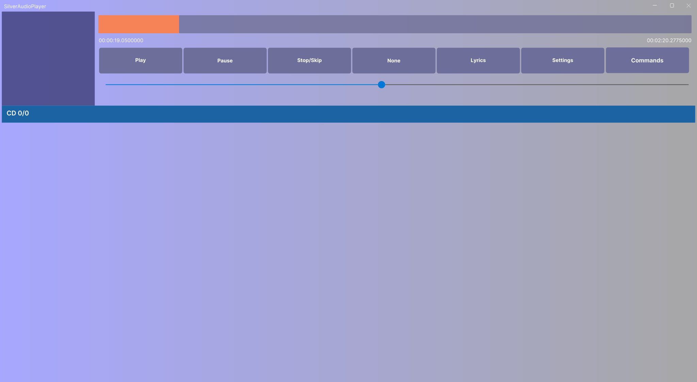

## Supported environments
Most platforms that can run dotnet 8  
To use the OpenAL backend a OpenAL implementation is needed, to use portaudio it's needed, same with libopenmpt and libvlc.  
Catenoid uses Avalonia which requires a display server X11/XWayland.
SilverAudioPlayer is tested and developed on KDE on an Arch based distribution (EndeavourOS).  

## What do you mean modular?
Modular means different things for different people but in this case modular would be defined as having code divided up into multiple optional components all housing important code but as previously mentioned are fully optional.
You don't want to be able to play midis? Remove the midi module  
You don't want to be able to play flacs? Remove the flac decoder  
You don't want to indirectly support google's duopoly by having the chromecast module? Remove it   
You don't want to be able to do anything with the player? Remove the player  
To remove a module you just need to delete the dll file associated with it (and optionally the configuration files)  

## Versioning
I introduce breaking changes with each update, since v4 I have been attempting to follow some sort of semver.
I make no promises. 
To sum it up where a.b.c.d are the version digits, if a is changed something major API breaking has happened you will have to modify your code to a large extent,  
if b is changed something might break your code but it probably won't update regardless,  
if c is changed you probably don't have to worry at all,   
changes in d shouldn't be noticeable at all.  

### Breaking changes since last major version
Too many things to count

## Module creation
Follow the [plugin guide](https://gitlab.com/silvercraft/SilverAudioPlayer/-/wikis/Create-a-new-plugin) (and let me know if any issues arise), for now attempt installing [SilverAudioPlayer.Shared](https://www.nuget.org/packages/SilverAudioPlayer.Shared/) to a class library containing a class that implements one of:
- `IPlayProvider` for implementing new players (most of the time you should just implement `INaudioWaveStreamWrapper` if a new player isn't needed to play that file)
- `IMetadataProvider` for implementing new metadata providers (the things that read metadata from files/streams)
- `IMusicStatusInterface` for implementing things that track/control playback (eg. discord rich presence/SMTC/Cd Art Display)
- `IWakeLockProvider` for implementing ways to let the OS know NOT to go to sleep
- `IPlayStreamProvider` for implementing ways of letting the user add new tracks from an external source (eg. internet radio streams, media servers (jellyfin(used to be a plugin, i don't wish to refractor it to work with the 2024 sdk), dlna, etc.))  
- `IPlayListReader` for reading playlists (m3u, m3u8, ...)
Consider looking through the already implemented modules as a reference  
**Don't forget to export your module by adding `[Export(typeof([YOURMODULEINTERFACETYPE]))]`**

## Goals and general TODO
Check out the [issues](https://gitlab.com/silvercraft/SilverAudioPlayer/-/issues)
